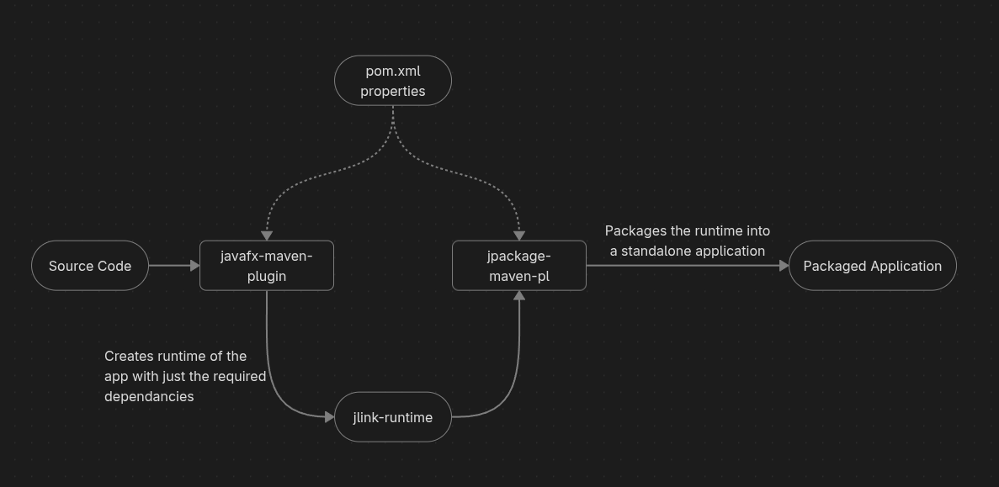

# Packaging Architecture
My personal gripe with a lot of the "guidance" about JavaFX packaging out there is, frankly, they fail to give a
general overview of how the packaging actually works. As useful as a complete pom.xml file is, I find it is quite a 
frustrating exercise to have to figure out what such "complete" solutions are actually doing to achieve the end-result.

As such, the following will be a top-level-view of how the packaging of a JavaFX app works, and what each individual part 
of the packaging process is responsible for. 

## Workflow Overview
The workflow of the packaging process is actually quite simple. The workflow is designed to solve 3 separate problems:

- How do you specify which Operating System you wish to package a JavaFX application for?
- How do you build a JavaFX application that only has what I need in it?
- How to package the built JavaFX application as a standalone application? 

These 3 problems are solved by the pom.xml properties, javafx-maven-plugin, and jpackage-maven-plugin respectfully.

 