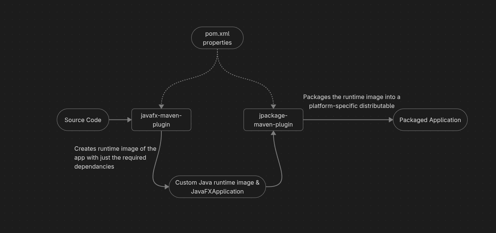

# 打包架構
我個人對網路上許多 JavaFX 打包「教學」的不滿是，坦白說，它們沒有提供打包實際運作方式的整體概覽。
完整的 pom.xml 雖然很有用，但要自己去弄懂這些「完整」方案到底做了什麼才達到最終結果，是件很令人沮喪的事。

因此，以下將從最上層的角度說明 JavaFX 應用程式的打包如何運作，以及打包流程中每個部分各自負責什麼。

## 流程概覽
打包流程其實相當簡單，目的是解決 3 個不同的問題：

- 如何指定要為哪個作業系統打包 JavaFX 應用程式？
- 如何建置一個只包含必要內容的 JavaFX 應用程式？
- 如何把建置好的 JavaFX 應用程式打包成獨立的應用程式？

這 3 個問題分別由 pom.xml 屬性、javafx-maven-plugin 和 jpackage-maven-plugin 解決。

### Maven pom.xml 屬性
為了簡化建置流程，`pom.xml` 大量使用屬性。與 JavaFX 相關的有主類別路徑、應用程式名稱與版本，
以及由各作業系統 profile 決定的打包類型。建置時會依據所在的作業系統套用對應的 profile。

這比把各種資訊寫死在 `pom.xml` 各處要好，原因有三：

1. 把所有可變的屬性集中在一處（pom.xml 的開頭附近），更容易找到也更容易修改。
當關鍵資訊散落在 `pom.xml` 各處時，更新時漏掉其中一個屬性是很常見的事。
2. 多個外掛都會用到的屬性（例如 JavaFX 應用程式的主類別路徑）只有單一來源，不需要在好幾個地方修改。
3. 有了作業系統 profile，不論在哪個作業系統上打包，開發者都能使用同一份 `pom.xml` 打包 JavaFX 應用程式。

更詳細的說明請參考 [Maven pom.xml 屬性](03-pom-xml-properties.md)。

### JavaFX Maven 外掛
JavaFX Maven 外掛的用途相對單純：建立 JavaFX 應用程式的執行環境映像檔（runtime image）。
在這裡，執行環境映像檔指的是一個獨立的套件，裡面包含 Java 執行環境以及執行 JavaFX 應用程式所需的所有模組。
這個映像檔通常只會包含 JavaFX 應用程式需要的元件。這讓 JavaFX 應用程式可以連同自己專屬的自訂執行環境一起打包，
使用者不必另外安裝 Java 就能執行。

表面上這似乎是個問題：只為了一個應用程式就打包整個 Java 執行環境，會讓發佈檔大得沒有必要。
解決方法是使用 JavaFX Maven 外掛內建的功能：使用 jlink 的相關選項。

jlink 是一個工具，可以產生只包含 JavaFX 應用程式執行所需模組的 Java 執行環境映像檔。
這樣得到的 Java 執行環境會小得多，而且是針對應用程式的需求量身打造的。

更詳細的說明請參考 [JavaFX Maven 外掛](04-javafx-maven-plugin.md)。

### jpackage Maven 外掛
雖然你現在有了自訂的 Java 執行環境映像檔，但用這種形式發佈 JavaFX 應用程式，對使用者來說並不方便。
視作業系統而定，使用者得自己下載並解壓縮執行環境映像檔的壓縮檔，在解壓後的資料夾中找到執行檔，
還要自己建立桌面捷徑之類的便利功能。

這時就輪到 jpackage（透過 jpackage Maven 外掛使用）上場了。這個外掛可以把 JavaFX 應用程式連同其自訂執行環境映像檔，
打包成針對目標作業系統的平台專用安裝檔。

更詳細的說明請參考 [jpackage Maven 外掛](05-jpackage-maven-plugin.md)。
